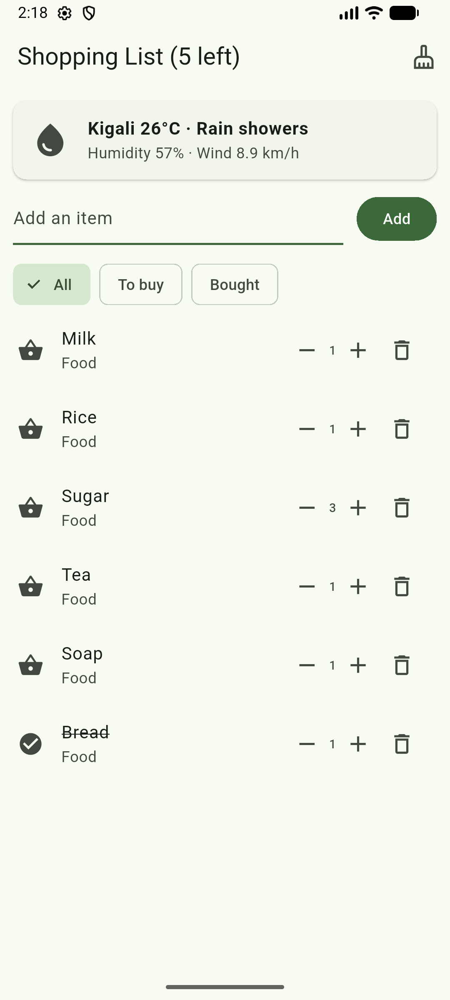
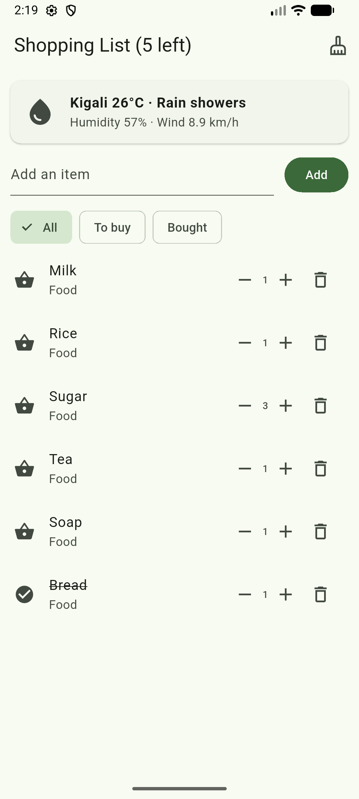
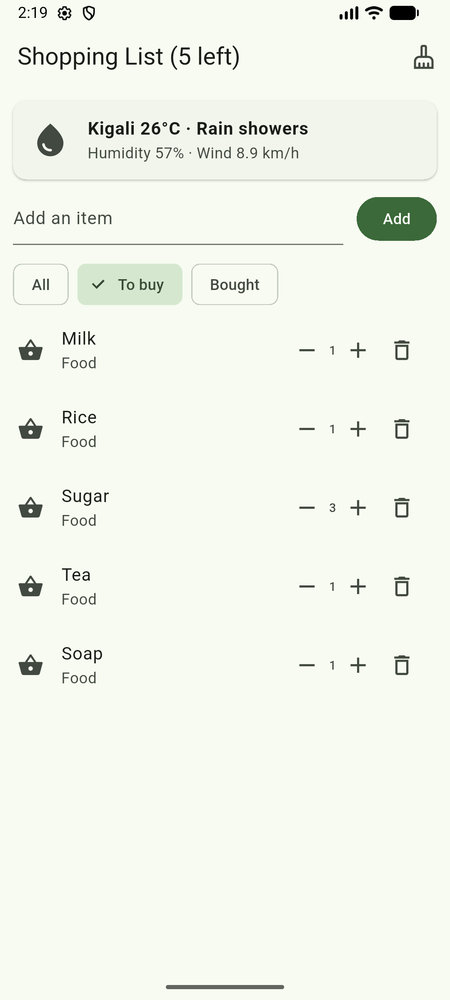
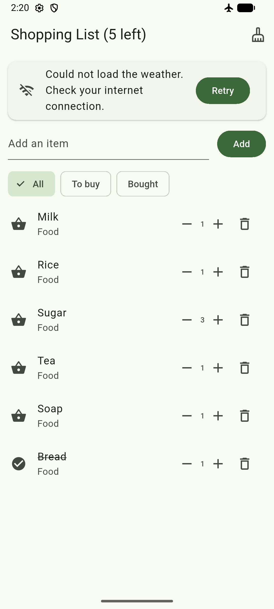

# Shopping List+

A Flutter shopping list built for Mobile Programming.

My data is now saved on the phone with `shared_preferences`, so nothing is lost when the
app closes, and it shows the live Kigali weather from the Open-Meteo API.

## Saving the list

Every item knows how to turn itself into a `Map` with `toJson`, and how to come back from
one with `Item.fromJson`. `saveItems` turns the whole list into text with `jsonEncode` and
writes it under the key `items`. `loadItems` reads that text back, decodes it, and rebuilds
the list.

`loadItems` runs once from `initState` when the app opens. `saveItems` runs after every
change: adding, raising a duplicate's quantity, the plus and minus buttons, marking an item
bought, deleting, undoing a delete, clearing the bought items, and editing on the details
screen.

## Live data from an API

A card at the top of the list shows the current weather in Kigali, asked from the free
Open-Meteo API. `lib/weather.dart` holds the `Weather` model with its `fromJson`, and
`fetchWeather`, which sends the GET request and throws if the server does not answer 200.

The card has the three states every screen that loads data needs:

- **Loading**: a small spinner and *Loading the weather...*
- **Error**: the request is inside `try` / `catch`, so with no internet the card shows a
  message and a **Retry** button instead of crashing.
- **Data**: the icon for the sky, the temperature rounded, the sky in words, the humidity
  and the wind.

## Earlier features

An empty list message, quantities with plus and minus, duplicate names raising the quantity
instead of adding a second row, undo after a delete, All / To buy / Bought filters, and a
details screen with a note and a category.

## Running it

```bash
flutter pub get
flutter run
```

## Screenshots








