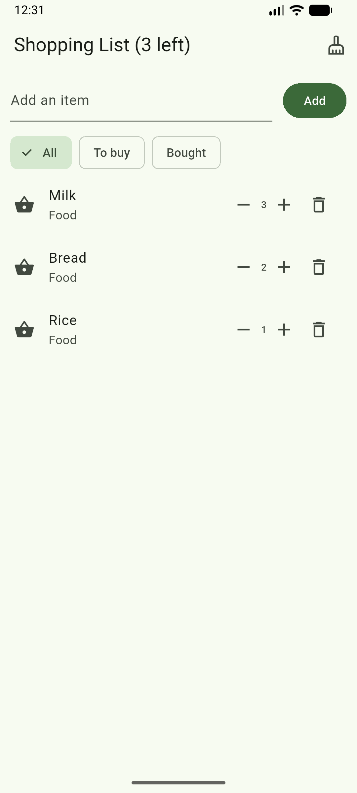
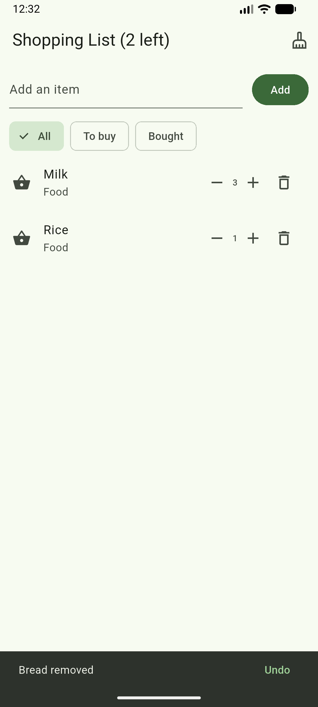
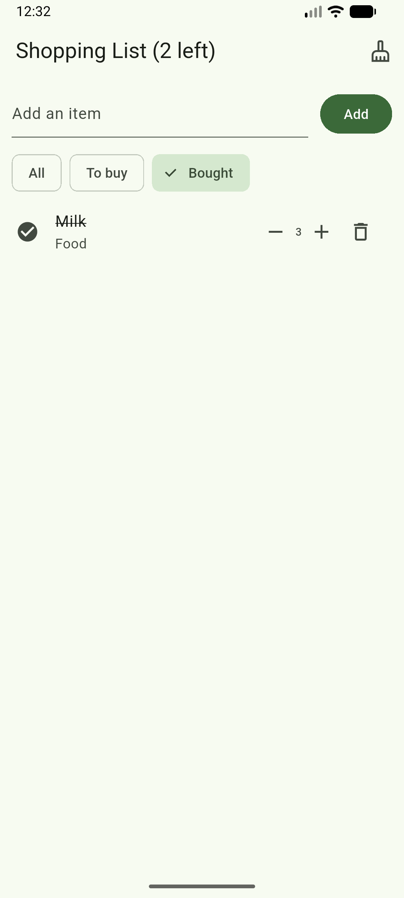
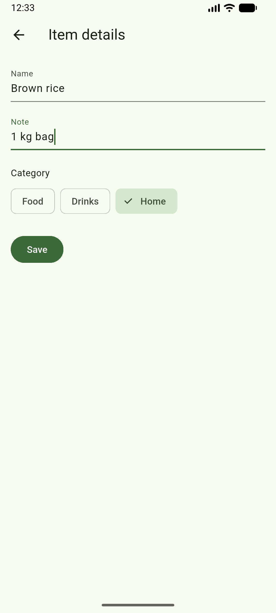

# Shopping List+

A Flutter shopping list app built for Mobile Programming, Week 2.

It started as the eight-step Shopping List from Session 3 and grew into six upgrades:
quantities, duplicate merging, undo, filters and a details screen.

## Running it

```bash
flutter pub get
flutter run
```

## Features

**1. Empty list message**
When every item has been deleted, the page shows *Your list is empty* in the middle
instead of a blank space. Adding an item brings the list straight back.

**2. Quantities**
Every item carries a quantity that starts at 1, shown on its row between a **−** and a
**+** button. **+** adds one, **−** takes one away but never goes below 1, so the only
way to remove an item completely is the bin.

**3. No duplicates, just more**
Adding something already on the list does not create a second row, whatever its capitals
or spaces. Typing ` mILK ` when Milk exists raises Milk to 2 and says
*Milk is already on the list: now ×2*.

**4. Undo a delete**
Deleting shows *Bread removed* with an **Undo** button. Undo puts the item back in exactly
the position it came from, keeping its quantity and its bought status.

**5. Filters**
Three chips sit under the input row: **All**, **To buy** and **Bought**. All shows
everything with the bought items pushed to the bottom, and the other two show only what
they name. When a filter has nothing to show the page says *Nothing here*, while a truly
empty list still says *Your list is empty*. Marking, −, +, delete and undo all work in
every filter.

**6. Item details**
A long press opens an **Item details** screen with the item's name and note in two text
fields and its category as three chips: Food, Drinks and Home. **Save** writes the changes
and returns to the list; an empty name is refused and keeps you on the screen. The back
arrow leaves the item untouched. Each row then shows its category and note under the name,
like **Drinks · the 1 litre bottle**.

## Screenshots

| Quantities | Undo |
| --- | --- |
|  |  |

| Bought filter | Item details |
| --- | --- |
|  |  |

## Think

**1. In part 5, why does deleting by `index` remove the wrong item when a filter is on?
How did you fix it?**

The ListView is built from `shown`, which is a filtered copy of `items`, so the `index`
the builder hands me is a position in `shown`, not in `items`. With no filter the two line
up and nothing looks wrong. Switch to **Bought** with only Milk showing and row 0 is Milk,
while `items[0]` is still Bread, so `items.removeAt(0)` quietly deletes Bread. Nothing
throws, which is what makes it dangerous.

I fixed it by deleting the object instead of a position. `removeItem` now takes the `Item`
itself and calls `items.remove(item)`, so it does not matter which list the row came from.
It also calls `items.indexOf(item)` first, because Undo still needs to know where the item
sat in the real list to put it back.

**2. Why did you have to remove `final` from `name`? Why is `final` still a good choice for
most fields?**

`final` means a field is given its value once, when the object is built, and can never be
assigned again. That was fine until part 6, where Save writes a new name into an item that
already exists with `widget.item.name = name`. Assigning to a `final` field is a compile
error, so `name` had to become an ordinary field.

`final` is still worth using wherever a value genuinely should not change, because the
compiler then stops you from changing it by accident. In this app `title` on `HomeScreen`
is `final`, and so are `items` and `controller`: the list object and the controller are
created once and never swapped for different ones, even though the contents of the list
change all the time. `final` locks the box, not what is inside it.

**3. Why did you need a hot restart after adding `quantity` to `Item`, when a save was
enough for everything else?**

Hot reload swaps in new code but keeps the objects the running app already made. Milk,
Bread and Rice were built before `Item` had a `quantity`, and a reload does not go back and
re-run the constructors that made them, so the rows would be reading a field those objects
never got. A hot restart throws the whole state away and runs `main()` again, which builds
the three items fresh from the new class.

The rule I took from it: a save is enough when only the drawing changes, but changing the
shape of the data needs a restart.

**4. The details screen changed the item, but the list only showed it after `setState` in
`.then`. Why? What does this tell you about how Flutter decides when to redraw?**

The details screen writes straight into the `Item` object, and an `Item` is a plain model
class, not a widget. It has no way to tell anyone it changed. The list's `State` therefore
never heard anything, its `build` was never called again, and the screen kept showing the
name it had drawn earlier. The data was already new; only the picture was old.

`.then` runs when the details screen is popped, and the `setState(() {})` inside it marks
the `HomeScreen` state as needing work, so Flutter calls `build` again and the row reads
the new name, note and category.

So Flutter does not watch my data for changes. It redraws when it is told to, and
`setState` is how it is told. Changing a model quietly is never enough on its own.

## What is in the code

| Piece | What it does |
| --- | --- |
| `Item` | The model: name, bought, quantity, note and category |
| `ShoppingApp` | The app, its theme and its first screen |
| `HomeScreen` / `_HomeScreenState` | The list screen, its data and its rules |
| `addItem()` | Refuses an empty name, merges duplicates, otherwise adds |
| `removeItem()` | Deletes by object and offers Undo |
| `shown` | The filtered list the ListView draws |
| `DetailsScreen` | The second screen, with Save and the category chips |
